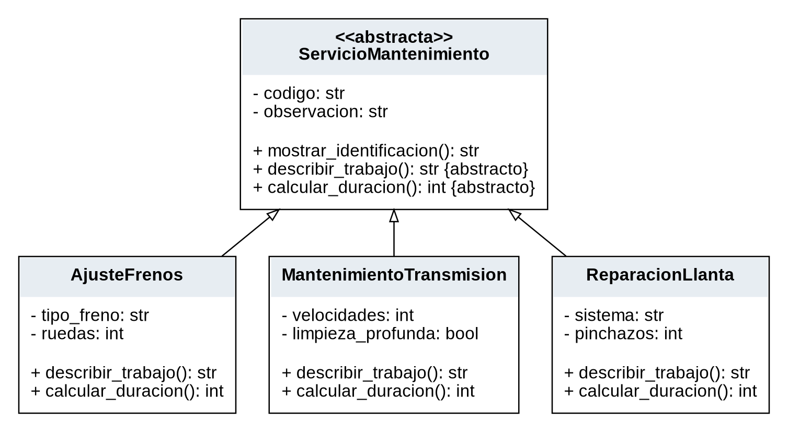
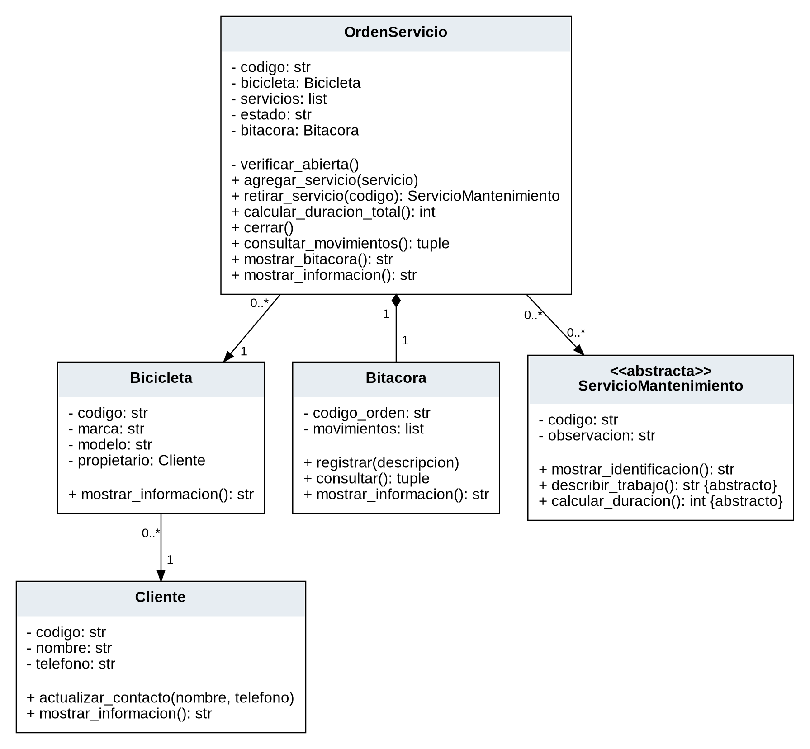

# Decisiones de Diseño de Órdenes de Mantenimiento de Bicicletas

Universidad de Manizales · Programación I · Actividad colaborativa 3

Hernan Felipe Astudillo Peña · Ingeniería en Analítica de Datos

Entrega individual · 7 de noviembre de 2026

## Introducción

El proyecto organiza las órdenes de mantenimiento de un taller de bicicletas. Permite identificar la bicicleta y su propietario, registrar los trabajos solicitados, estimar su duración y conservar una secuencia de movimientos. El problema concreto es evitar servicios repetidos, retiros incorrectos y cierres que dejen una orden vacía o permitan modificar una orden ya finalizada.

La solución aplica los conceptos de Programación Orientada a Objetos en un contexto distinto al sistema académico de las entregas anteriores. Su alcance se limita al registro del mantenimiento: no administra ventas ni inventario comercial. Los datos son ficticios y los tiempos constituyen supuestos didácticos.

## Descripción general de la solución

El programa tiene un único punto de entrada, `main.py`. Las entidades se encuentran en `modelos/`, las excepciones en `excepciones.py` y las pruebas en `pruebas/`. El diseño comprende siete clases concretas y una abstracta; las clases de excepciones no se incluyen en ese conteo.

| Clase | Responsabilidad |
| --- | --- |
| Cliente | Identificar al propietario y actualizar su nombre y teléfono. |
| Bicicleta | Representar la bicicleta y conservar el objeto propietario. |
| ServicioMantenimiento | Definir la información común y el contrato abstracto de cada trabajo. |
| AjusteFrenos | Describir y estimar un ajuste según tipo de freno y ruedas. |
| MantenimientoTransmision | Describir y estimar el trabajo según velocidades y limpieza. |
| ReparacionLlanta | Describir y estimar el trabajo según sistema y pinchazos. |
| OrdenServicio | Reunir servicios, calcular duración, controlar el estado y registrar movimientos. |
| Bitacora | Conservar y presentar la secuencia de operaciones aceptadas de una orden. |

### Información y límites

La demostración crea dos clientes, dos bicicletas, seis servicios y dos órdenes. Cada orden construye su bitácora, para un total de 14 objetos. Los registros permanecen en memoria y se recrean en cada ejecución. El cierre es administrativo y no certifica una reparación física. No se incluyen agenda, pagos, repuestos, autenticación ni persistencia.

## Abstracción y especialización de los servicios

`ServicioMantenimiento` hereda de `ABC`. No debe instanciarse porque un trabajo sin especialidad no tiene una descripción ni una duración definidas. Declara como abstractos `describir_trabajo()` y `calcular_duracion()`. La creación directa de esta clase, o de una hija que no complete el contrato, produce `TypeError`.

Las tres hijas representan relaciones naturales de especialización: un ajuste de frenos, un mantenimiento de transmisión y una reparación de llanta son servicios de mantenimiento. Reutilizan los atributos privados código y observación, sus getters y `mostrar_identificacion()`. Cada constructor llama a `super().__init__()` antes de inicializar y validar sus datos particulares.

### Datos propios y métodos sobrescritos

`AjusteFrenos` añade tipo de freno y cantidad de ruedas. Su descripción incorpora esos datos y su duración es 12 minutos por rueda, más 8 para disco. `MantenimientoTransmision` añade velocidades y limpieza profunda; estima 15 minutos base, más 2 por velocidad y 20 si la limpieza es profunda. `ReparacionLlanta` añade sistema y pinchazos; estima 10 minutos base, más 8 por pinchazo y 10 para tubeless.

Ambos métodos conservan el mismo nombre en las tres hijas, pero utilizan información particular y producen respuestas diferentes. Las cifras son reglas del ejemplo, no estándares técnicos. Los servicios exponen consultas y no setters para su configuración, de modo que sus datos no se modifican a través de la interfaz después de incorporarlos a una orden.

## Relaciones entre objetos

La bicicleta recibe un Cliente existente y la orden recibe una Bicicleta existente. `agregar_servicio()` recibe un servicio concreto. Estas relaciones conservan objetos, no nombres como sustitutos. Por eso una actualización del nombre del cliente se refleja al consultar su bicicleta.

El triángulo vacío representa generalización y el rombo lleno representa composición. Las multiplicidades muestran que cada bicicleta tiene un propietario, cada orden tiene una bicicleta y una bitácora, y una orden puede reunir varios servicios. El modelo permite compartir un servicio entre órdenes; el control de códigos duplicados se aplica dentro de cada orden. Las vistas ampliables y las fuentes están en `docs/UML.md`.

## Composición y encapsulamiento

`OrdenServicio` construye `Bitacora(self.__codigo)` dentro de su constructor y registra la apertura. La bitácora es una parte esencial de su estructura: conserva las altas, los retiros y el cierre de esa orden. No se recibe una bitácora externa ni se comparte mediante la interfaz pública de OrdenServicio.

La relación expresa que una orden tiene una bitácora. Heredar de Bitacora afirmaría que una orden es una secuencia de movimientos y mezclaría la gestión del trabajo con su registro. La composición permite que la orden coordine las operaciones y delegue en la bitácora el almacenamiento y la presentación de esa secuencia. Esta responsabilidad de creación y uso no equivale a una garantía de destrucción inmediata de objetos en Python.

### Protección de los datos

Los atributos de las entidades usan dos guiones bajos. Se consultan mediante métodos y solo se modifican mediante operaciones previstas. Esa convención evita accesos accidentales, pero no representa una barrera de seguridad absoluta. `Cliente.actualizar_contacto()` valida el nombre y el teléfono antes de asignar cualquiera; un teléfono vacío conserva ambos datos anteriores.

`get_servicios()` y `consultar_movimientos()` entregan tuplas. Una copia modificable de esas consultas no puede alterar las listas internas. En los servicios se conservan las referencias a los mismos objetos; no se realiza una copia profunda. El total se calcula mediante la suma de sus duraciones, sin mantener un segundo contador que pueda quedar desactualizado.

### Reglas del estado de la orden

Una orden comienza abierta y sin servicios. Mientras está abierta permite agregar y retirar trabajos. El cierre exige al menos uno y cambia el estado a cerrada. Después puede consultarse, pero no acepta altas, retiros ni un nuevo cierre. La comprobación se centraliza en el método privado `__verificar_abierta()`.

Los códigos se comparan exactamente después de retirar espacios externos. No existe un registro global de identificadores ni se exige que una bicicleta tenga una sola orden. La bitácora registra operaciones aceptadas, no intentos rechazados, y conserva su secuencia sin marcas de fecha. Estos límites corresponden al alcance del proyecto.

## Excepciones propias del taller

El sistema define cuatro clases específicas derivadas de `ErrorTaller`, cuya base es `Exception`. Cada excepción se lanza desde el método que detecta el problema. `main.py` la captura, presenta un mensaje con el código involucrado y continúa con la demostración.

### Servicio duplicado

`ServicioDuplicadoError` se lanza en `OrdenServicio.agregar_servicio()` cuando otro servicio tiene el mismo código dentro de la orden. Detecta tanto el mismo objeto como una instancia diferente con ese código. La comprobación ocurre antes de añadir o registrar el movimiento, por lo que no modifica los servicios, la duración ni la bitácora.

### Servicio ausente

`ServicioNoEncontradoError` se genera en `retirar_servicio()` cuando no se encuentra el código solicitado. El método conserva la lista y no registra un retiro inexistente. Si lo encuentra, elimina la referencia, registra el movimiento y devuelve el objeto retirado, que puede agregarse de nuevo mientras la orden permanezca abierta.

### Cierre de una orden vacía

`OrdenSinServiciosError` se lanza en `cerrar()` si la orden abierta no tiene trabajos. Se evita dejar una orden cerrada sin contenido. Después de la captura se le pueden agregar servicios y cerrar correctamente.

### Modificación de una orden cerrada

`OrdenCerradaError` se genera en `__verificar_abierta()`, invocado al comienzo de agregar, retirar y cerrar. Una orden cerrada mantiene su estado y su historial frente a cualquiera de esas operaciones. La excepción no impide las consultas.

### Captura y recuperación

El programa utiliza cuatro bloques `try/except` específicos para estos errores. Tras cada captura muestra una continuación y realiza una operación posterior. También controla un `ValueError` por contacto inválido y un `TypeError` por la clase abstracta. Los modelos no imprimen errores; entregan resultados o lanzan excepciones, y el programa principal decide cómo presentarlos.

## Polimorfismo y verificación

`crear_datos_demo()` construye una sola lista de demostración que alterna dos objetos de cada tipo de servicio. `mostrar_reporte_servicios()` recorre esa colección con un único ciclo e invoca `describir_trabajo()` y `calcular_duracion()` en todos sus elementos. Python selecciona la implementación de cada objeto. No hay condicionales de tipo en ese recorrido.

Los condicionales dentro de los servicios aplican reglas sobre disco, limpieza o tubeless; no reemplazan el despacho polimórfico. Los controles `isinstance()` de las asociaciones validan las entradas. Una prueba añade la subclase LimpiezaCuadro únicamente para comprobar que el reporte admite otro tipo sin modificar su ciclo.

### Casos comprobados

El 7 de noviembre de 2026 se ejecutaron la demostración y las 34 pruebas de `unittest` con Python 3.12.14. Todas pasaron. Se comprobaron el contrato abstracto, los campos particulares, las duraciones, las asociaciones, el encapsulamiento, la composición y los cuatro errores del dominio. Las salidas reales están en `docs/salida_demostracion.txt` y `docs/resultado_pruebas.txt`.

La orden O01 recibe F01, T01 y L01 y suma 99 minutos. El duplicado se rechaza. Retirar L01 reduce el total a 81; el retiro de S99 falla; agregar L01 de nuevo recupera los 99. O02 no puede cerrarse vacía, pero recibe sus tres servicios y cierra con 81 minutos. O01 rechaza un cambio posterior al cierre. La ejecución termina consultando las dos órdenes y sus bitácoras independientes.

### Estado después de los errores

Las pruebas no se limitan a esperar excepciones: comparan el contenido, el tiempo y los movimientos antes y después de los rechazos. También prueban límites y tipos incorrectos, incluyendo booleanos usados como cantidades. El cierre repetido y el retiro de una orden cerrada se verifican en la suite, además del intento de agregar mostrado en la demostración.

### Cómo repetir la comprobación

Desde la carpeta que contiene `main.py`, ejecutar `py main.py` y después `py -m unittest discover -s pruebas -v` en Windows. En Linux o macOS puede utilizarse `python3`. El proyecto solo requiere Python y su biblioteca estándar; Graphviz y las herramientas de documentos se emplearon para preparar los entregables, no para ejecutar el sistema.

## Revisión de decisiones y herramientas utilizadas

Durante el diseño se evaluó añadir una clase Taller para centralizar todos los registros. Se descartó porque las operaciones delimitadas quedan en OrdenServicio y no se implementa un catálogo global. También se descartó incorporar un menú interactivo: la demostración automática permite reproducir todos los casos normales y excepcionales desde el mismo punto de entrada.

Se eligieron tuplas para las consultas frente a la alternativa de entregar las listas internas. Asimismo, se calculó la duración desde los servicios en lugar de almacenar un total adicional. Estas decisiones reducen los caminos por los que los datos podrían quedar inconsistentes. En la revisión gráfica se ajustaron las etiquetas de multiplicidad del UML para evitar superposiciones y conservar legibilidad.

### Declaración de asistencia de inteligencia artificial

Se utilizó ChatGPT de OpenAI para analizar el enunciado, proponer el contexto y la estructura, generar la implementación, escribir y ejecutar las pruebas, preparar el UML y redactar la documentación. Las propuestas de una clase contenedora adicional y de una interfaz interactiva se descartaron al delimitar el alcance. Las reglas de duración propuestas se identificaron expresamente como supuestos didácticos.

Python y `unittest` se utilizaron para ejecutar y comprobar el sistema; Graphviz, para producir las figuras UML; y python-docx y LibreOffice, para preparar y revisar el documento. Estas herramientas no son modelos adicionales de IA. La implementación asistida y su evidencia no certifican una revisión personal ya realizada. La comprensión y sustentación de la totalidad del proyecto corresponden a Hernan Felipe Astudillo Peña, único estudiante responsable.

## Conclusiones

El modelo reúne el registro de bicicletas y los trabajos de mantenimiento en una sola aplicación. La clase abstracta exige comportamientos completos, las hijas calculan y describen trabajos específicos y la orden los procesa mediante una interfaz común. La bitácora demuestra composición con una responsabilidad concreta.

Los puntos que requirieron mayor cuidado fueron distinguir relaciones de herencia y asociación, proteger las colecciones y conservar el estado ante errores. Las pruebas muestran por qué validar antes de modificar evita inconsistencias. El ejercicio permite relacionar los conceptos de POO con decisiones verificables en el código; su alcance queda limitado al registro administrativo en memoria.

## Referencias

Universidad de Manizales. Actividad colaborativa N°3. Proyecto Final. Documento del curso Programación I suministrado para esta actividad.

Python Software Foundation. Documentación de Python 3.12, consultada el 7 de noviembre de 2026:

https://docs.python.org/es/3.12/library/abc.html

https://docs.python.org/es/3.12/tutorial/errors.html

https://docs.python.org/es/3.12/library/unittest.html
