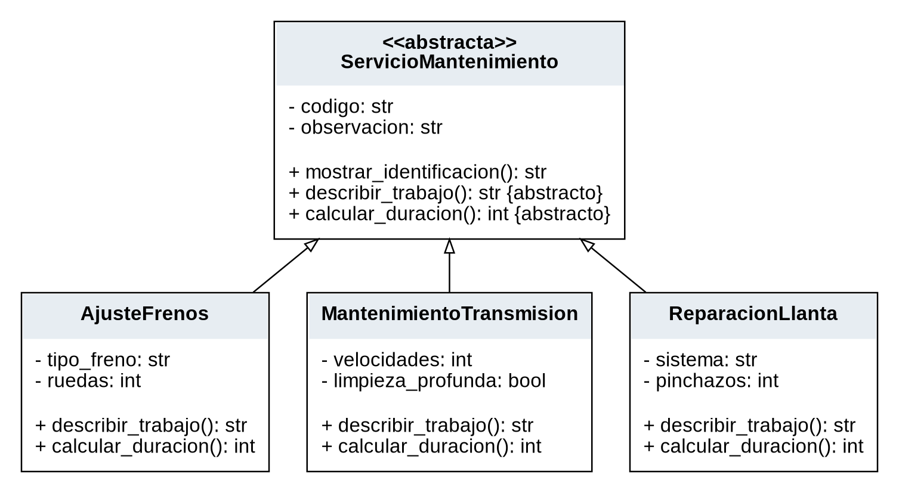
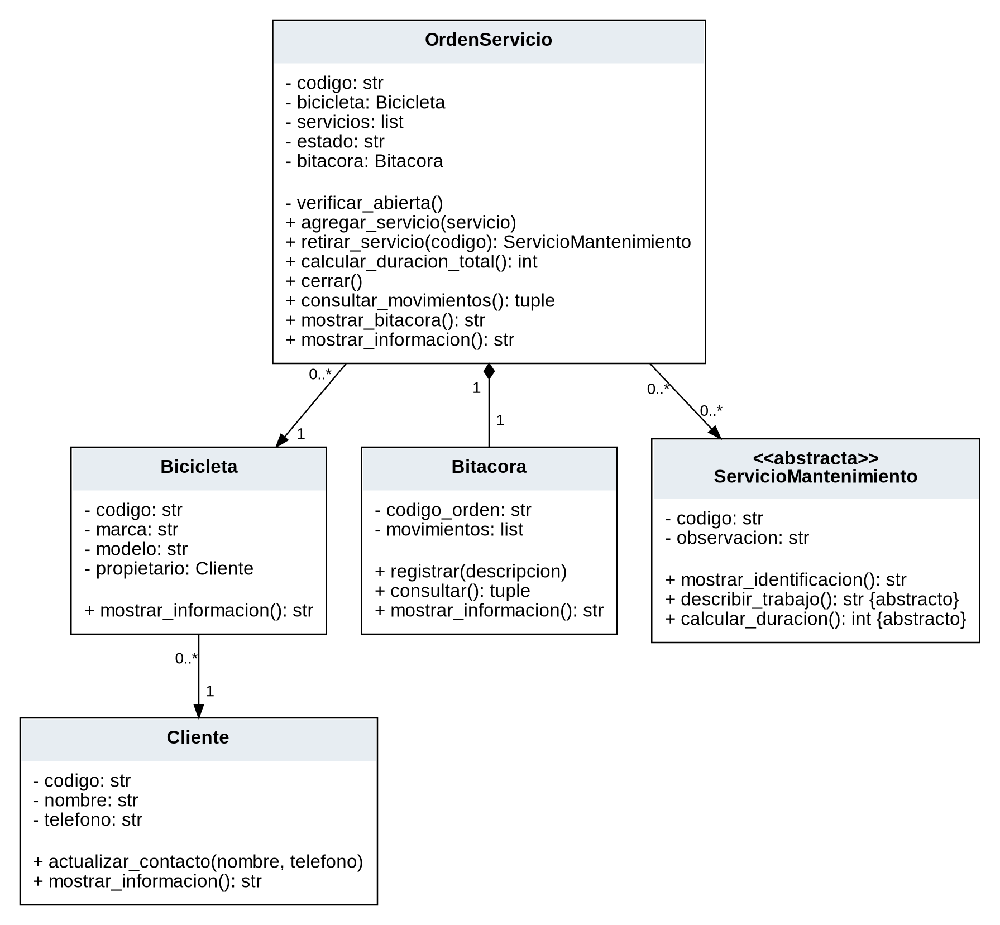
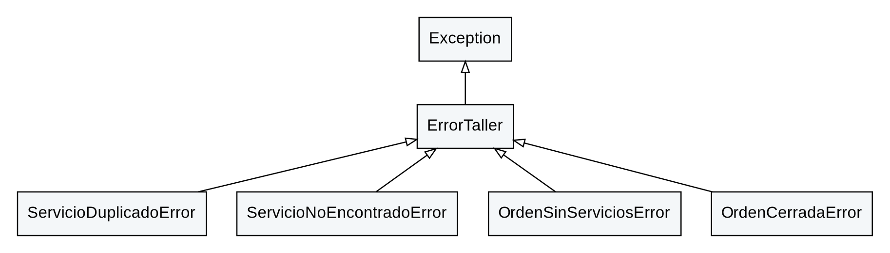

# Diagrama UML de clases

El modelo se presenta en tres vistas complementarias para mantener legibles sus
atributos, operaciones y relaciones. Corresponde a las clases implementadas.
Se muestran los métodos principales; los constructores y getters se omiten en
las figuras para reducir repetición. Los nombres privados de Python con `__`
aparecen con el signo UML `-`; `+` indica una operación pública.

## Generalización y especialización

[Abrir SVG ampliable](uml_herencia.svg) · [Fuente DOT](uml_herencia.dot)

El triángulo vacío apunta a ServicioMantenimiento, la clase abstracta. Las tres
hijas implementan describir_trabajo() y calcular_duracion().

## Asociaciones y composición

[Abrir SVG ampliable](uml_relaciones.svg) · [Fuente DOT](uml_relaciones.dot)

Cada bicicleta referencia un Cliente y cada orden referencia una Bicicleta.
El modelo permite asociar varias bicicletas a un cliente y varias órdenes a una
bicicleta. Una orden contiene de cero a muchos servicios; un mismo objeto servicio
puede ser referenciado por varias órdenes. La unicidad por código se controla
dentro de cada orden, no entre órdenes.

El rombo lleno se ubica en OrdenServicio: esta crea exactamente una Bitacora
propia. El registro no se recibe desde fuera ni se comparte entre órdenes a
través de su interfaz. La composición describe esta responsabilidad de creación
y uso; no implica una garantía de destrucción inmediata en Python.

## Excepciones del dominio

[Abrir SVG ampliable](uml_excepciones.svg) · [Fuente DOT](uml_excepciones.dot)

Las cuatro excepciones no se cuentan entre las siete entidades concretas del
proyecto. Exception pertenece a la biblioteca estándar de Python.

La [fuente Mermaid del modelo de entidades](uml_clases.mmd) permite mantener
una representación textual adicional del mismo diseño.
